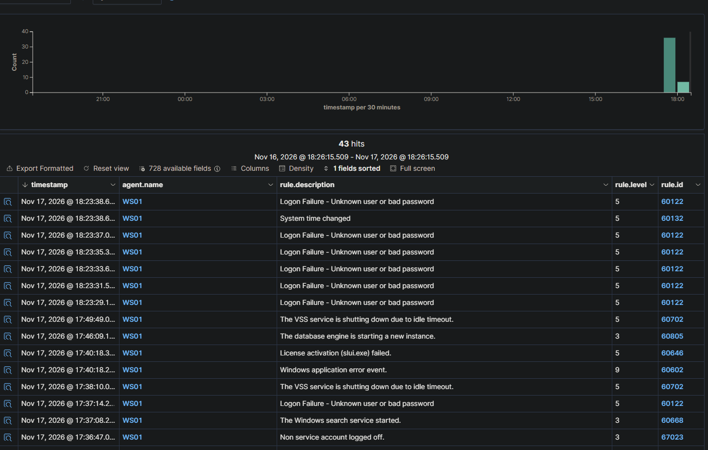
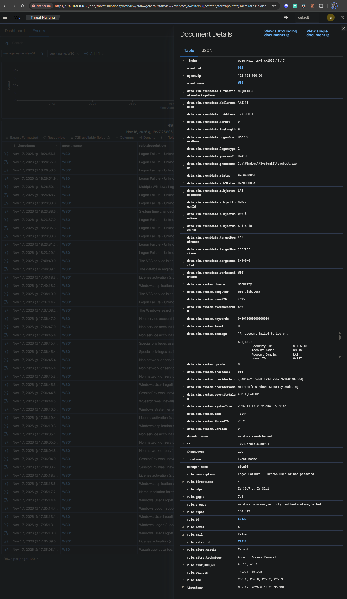
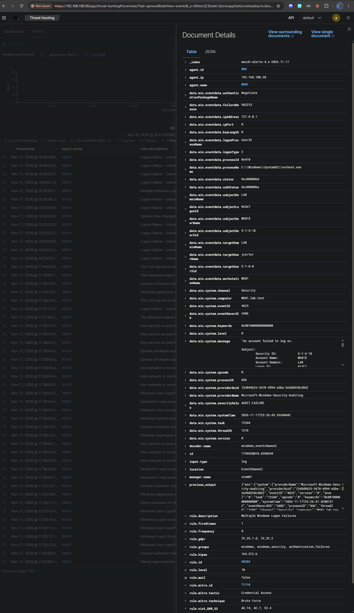

# Investigation 01 — Brute-Force Authentication Detection

**Date:** November 17, 2026  
**Environment:** Active Directory Detection Lab  
**SIEM:** Wazuh 4.14.10  
**Affected Account:** `LAB\jcarter`  
**Source Workstation:** WS01 (`192.168.100.20`)  
**Domain Controller:** DC01 (`192.168.100.10`)  
**MITRE ATT&CK:** T1110 — Brute Force  
**Final Classification:** Authorized Security Simulation  
**Status:** Closed — Expected Activity

---

## 1. Investigation Summary

A controlled brute-force authentication simulation was conducted against the Active Directory domain account `LAB\jcarter` from the domain-joined Windows 11 workstation WS01.

Multiple incorrect passwords were submitted within a short period to simulate repeated authentication failures.

Windows recorded the failed authentication attempts through Security Event IDs **4625** and **4771**. The Wazuh agents installed on WS01 and DC01 successfully forwarded the relevant security events to the centralized Wazuh SIEM.

After repeated authentication failures, Wazuh triggered its built-in correlation rule **60204 — Multiple Windows Logon Failures**, generating a **Level 10 security alert**.

The detection demonstrated Wazuh's ability to correlate repeated authentication failures and identify behavior associated with brute-force password attacks.

### Evidence 1 — Repeated Authentication Failures



*Figure 1: Wazuh Threat Hunting displays repeated authentication failures originating from WS01, with corresponding security events recorded by DC01. The events demonstrate that authentication telemetry was successfully collected from both systems.*

---

## 2. Relevant Security Events

| Event / Rule | Description | Source |
|---|---|---|
| Windows 4625 | Failed interactive logon | WS01 |
| Windows 4771 | Kerberos pre-authentication failed | DC01 |
| Wazuh 60122 | Logon Failure — Unknown user or bad password | WS01 |
| Wazuh 60104 | Windows audit failure event | DC01 |
| Wazuh 60204 | Multiple Windows Logon Failures | WS01 |

The workstation's Event ID **4625** identified the affected account as `jcarter`, with **Logon Type 2 (Interactive)**.

The corresponding domain-controller authentication failures included Kerberos failure code `0x18`, indicating invalid pre-authentication information consistent with an incorrect password.

The workstation events recorded `127.0.0.1` in the source IP field, reflecting the local interactive authentication context.

### Evidence 2 — Windows Security Event ID 4625



*Figure 2: Detailed Windows authentication-failure telemetry collected by Wazuh. The event identifies the affected account, failed authentication status, logon type, and source workstation.*

### Event Analysis

**Affected User:** `LAB\jcarter`  
**Workstation:** WS01  
**Windows Event ID:** 4625  
**Logon Type:** 2 — Interactive  
**Authentication Result:** Failure  
**Wazuh Rule:** 60122  
**Alert Severity:** Level 5

The event confirms an unsuccessful interactive logon attempt involving the targeted domain account.

An individual authentication failure is not sufficient to establish a brute-force attack. However, repeated failures against the same account within a short interval can indicate password guessing or automated authentication attempts.

This distinction is important because individual failed logins may occur during normal user activity, while repeated failures can warrant additional investigation.

---

## 3. Detection Rule Analysis

The triggered Wazuh rule contained the following configuration:

| Parameter | Value |
|---|---|
| Rule ID | `60204` |
| Description | Multiple Windows Logon Failures |
| Severity | Level 10 |
| Frequency | 8 |
| Timeframe | 240 seconds |
| Matched Group | `authentication_failed` |
| Correlation Field | `win.eventdata.ipAddress` |
| MITRE ATT&CK | T1110 — Brute Force |

### Rule Configuration

The following XML represents the relevant detection logic from Wazuh's built-in rule:

```xml
<rule id="60204" level="10" frequency="$MS_FREQ" timeframe="240">
    <if_matched_group>authentication_failed</if_matched_group>
    <same_field>win.eventdata.ipAddress</same_field>
    <description>Multiple Windows Logon Failures</description>
    <options>no_full_log</options>
</rule>
```

The frequency variable is defined in the ruleset as:

```xml
<var name="MS_FREQ">8</var>
```

### Detection Logic

Rule 60204 monitors repeated authentication-failure events and correlates activity sharing the same source IP address within the configured four-minute window.

During the simulation, Wazuh initially generated individual **Level 5 authentication-failure alerts**.

After sufficient matching events were processed, Wazuh generated the **Level 10 correlation alert**.

**Observed detection timestamp:** November 17, 2026, approximately 18:26:50 (Wazuh event display).

### Evidence 3 — Wazuh Brute-Force Detection



*Figure 3: Wazuh's built-in Rule 60204 triggered after repeated failed authentication attempts. The Level 10 alert confirms successful correlation of multiple authentication-failure events and maps the activity to MITRE ATT&CK T1110 — Brute Force.*

### Detection Significance

The triggering of Rule 60204 demonstrates the difference between an individual security event and a correlated security alert.

**Individual Detection:**

- Windows records an unsuccessful logon.
- Wazuh processes the security event.
- Rule 60122 identifies the authentication failure.
- A Level 5 alert is generated.

**Correlated Detection:**

- Multiple authentication failures occur within the configured time window.
- Wazuh evaluates repeated failures using its correlation logic.
- Rule 60204 identifies the repeated authentication-failure pattern.
- A Level 10 alert is generated.

This escalation helps distinguish isolated authentication failures from repeated behavior that may require greater scrutiny.

---

## 4. Investigation Findings

The investigation established the following:

- Multiple unsuccessful authentication attempts targeted the same Active Directory user account.
- The attempts originated from the domain-joined workstation WS01.
- Windows auditing successfully recorded the authentication failures.
- Wazuh received relevant security telemetry from both WS01 and DC01.
- The repeated failures satisfied Wazuh's built-in correlation conditions.
- Rule 60204 generated a Level 10 alert identifying repeated authentication failures.
- The alert was associated with MITRE ATT&CK technique **T1110 — Brute Force**.

### Event Correlation

Security events from WS01 and DC01 provided complementary authentication information.

**WS01** recorded the unsuccessful interactive logon through Windows Event ID 4625.

**DC01** recorded corresponding Kerberos pre-authentication failures through Windows Event ID 4771.

These records helped establish that the authentication activity involved a domain account and originated from the lab workstation.

The Wazuh correlation alert demonstrated that repeated authentication failures could be detected through the centralized monitoring environment.

The activity was deliberately generated within an isolated VMware lab for detection validation.

No unauthorized attacker activity was identified during this investigation.

---

## 5. Analyst Assessment

**Classification:** Authorized Security Simulation — True Positive Detection

The Level 10 alert correctly identified a pattern of repeated failed authentication attempts consistent with brute-force behavior.

Although the activity was intentional and authorized, the detection itself was a true positive because the observed behavior matched the rule's intended detection criteria.

In a production SOC environment, a comparable alert would warrant additional investigation into:

- The affected user account and its authentication history.
- The source workstation or IP address.
- The number and frequency of failed authentication attempts.
- Whether multiple accounts were targeted.
- Whether successful authentication followed the failures.
- Whether the account exhibited unusual activity after authentication.
- Whether the activity originated from an expected device or location.
- Whether the authentication failures were associated with an authorized test or known operational issue.

### Security Impact

Repeated failed authentication attempts can indicate password guessing, brute-force activity, or misconfigured applications using outdated credentials.

However, a series of failed authentication attempts alone does not establish that an account was compromised.

The investigation did not identify a successful unauthorized authentication or subsequent malicious activity.

**No successful compromise was demonstrated during this simulation.**

---

## 6. Conclusion

The authentication detection test was successful.

Windows Advanced Audit Policy provided the necessary authentication telemetry, while Wazuh centralized and analyzed the resulting security events.

The experiment demonstrated the difference between individual authentication-failure alerts and correlation-based detections.

Wazuh successfully escalated repeated Level 5 authentication failures into a Level 10 alert using its existing detection rule 60204.

The investigation validated the lab's capability to monitor Active Directory authentication activity, correlate repeated security events, and identify behavior consistent with brute-force password attempts.

The collected screenshots provide evidence of:

1. Repeated authentication failures appearing in Wazuh.
2. Windows Event ID 4625 containing authentication-failure details.
3. Wazuh Rule 60204 generating a Level 10 correlation alert.

**Final Disposition:** Closed — Authorized simulation; no malicious incident confirmed.

---

## 7. Skills Demonstrated

- Active Directory security auditing
- Windows Event Log analysis
- Wazuh SIEM administration
- Authentication monitoring
- Event correlation and detection validation
- Security alert triage
- MITRE ATT&CK mapping
- Security incident investigation
- Technical documentation

---

**Project:** [Active Directory Detection Lab](../README.md)

**Investigation Status:** Completed  
**Detection Result:** Successful — Wazuh Rule 60204 triggered
