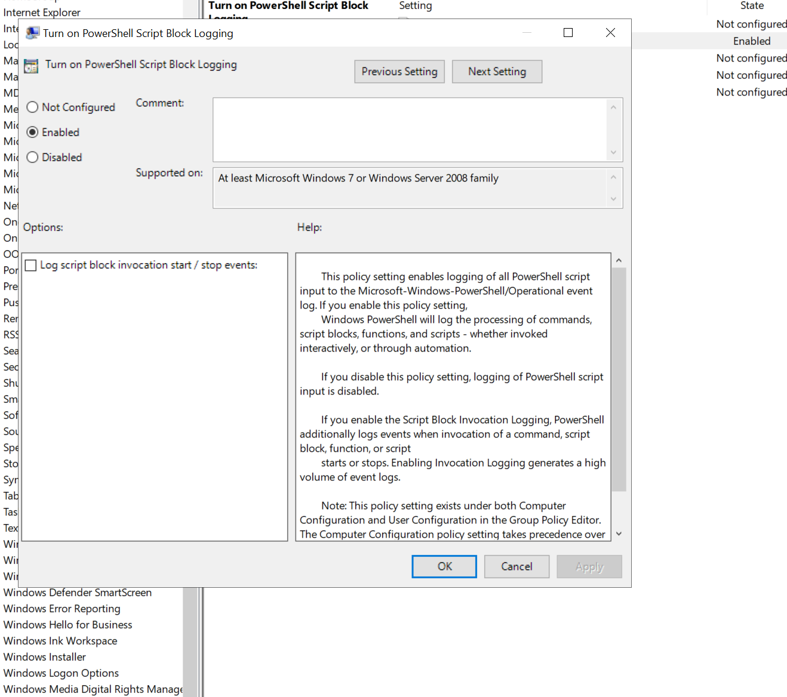
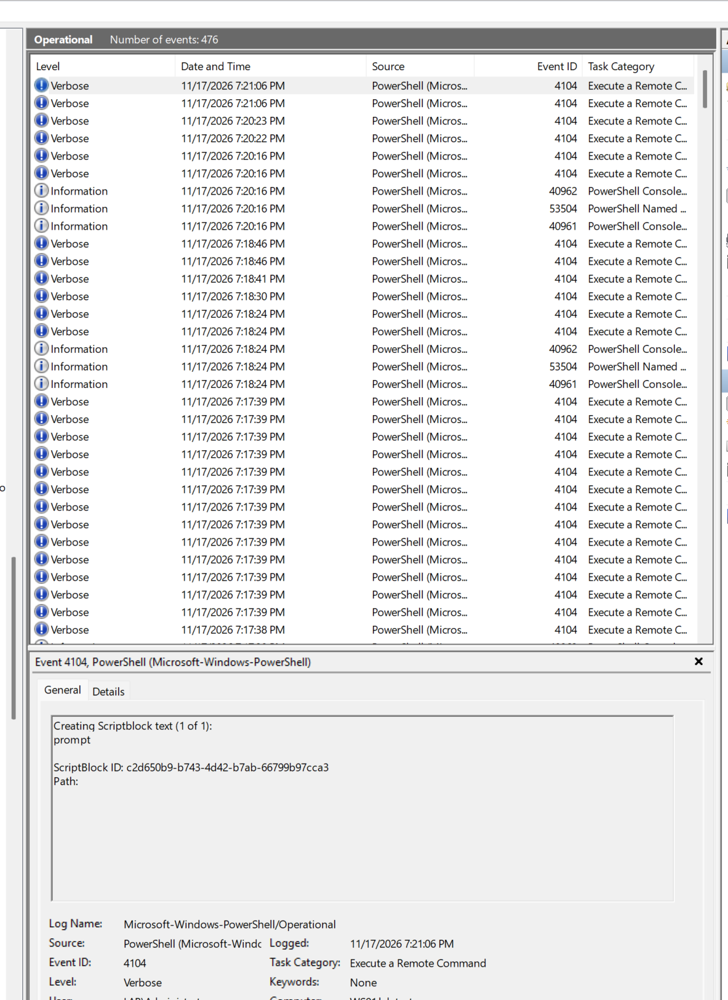
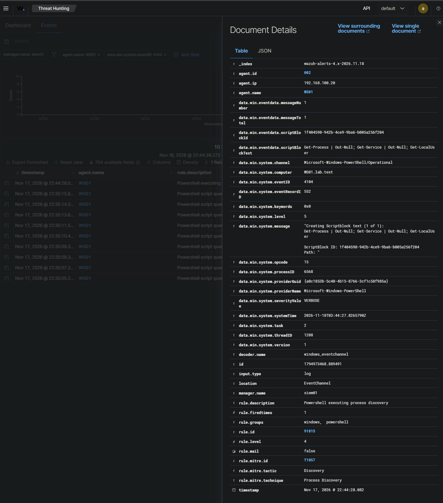

# Investigation 02 — PowerShell Process Discovery Detection

**Date:** November 17, 2026  
**Environment:** Active Directory Detection Lab  
**SIEM:** Wazuh 4.14.10  
**Affected Endpoint:** WS01 (`192.168.100.20`)  
**Domain:** `lab.test`  
**Detection Source:** PowerShell Script Block Logging  
**MITRE ATT&CK:** T1057 — Process Discovery  
**Final Classification:** Authorized Security Simulation  
**Status:** Closed — Expected Activity

---

## 1. Investigation Summary

A controlled PowerShell discovery simulation was conducted on the domain-joined Windows 11 workstation WS01 to evaluate endpoint monitoring and detection capabilities.

The test involved executing PowerShell commands that enumerated running processes, Windows services, and local user accounts. These commands simulate discovery techniques that an attacker might use to gather information about a compromised endpoint.

PowerShell Script Block Logging, enabled through Active Directory Group Policy, recorded the executed commands as Windows Event ID **4104**.

The Wazuh agent forwarded the PowerShell event to the centralized SIEM, where built-in detection rule **91815 — PowerShell executing process discovery** generated a **Level 4 alert**.

The investigation demonstrated successful PowerShell script collection, detection rule matching, and MITRE ATT&CK mapping.

---

## 2. Lab Environment

| Component | Configuration |
|---|---|
| Domain | `lab.test` |
| Domain Controller | DC01 — Windows Server 2022 |
| Workstation | WS01 — Windows 11 |
| Workstation IP | `192.168.100.20` |
| SIEM Server | SIEM01 — Ubuntu Server / Wazuh 4.14.10 |
| Wazuh Agent | WS01 — Agent ID 002 |
| Endpoint Monitoring | Microsoft Sysmon 15.22 |
| PowerShell Logging | Script Block Logging enabled through Group Policy |

### Logging Configuration

A Group Policy Object named `SOC-Lab-Workstation-PowerShell-Logging` was created and linked to the Workstations organizational unit.

The following policy was enabled:

`Computer Configuration > Policies > Administrative Templates > Windows Components > Windows PowerShell > Turn on PowerShell Script Block Logging`

The policy was successfully applied to WS01 and verified using:

```powershell
gpresult /scope computer /r
```

### Evidence 1 — PowerShell Logging Group Policy



*Figure 1: Group Policy Management Editor showing that PowerShell Script Block Logging was enabled through a dedicated workstation GPO. This configuration allows Windows to record executed PowerShell script blocks for security monitoring.*

### Wazuh Agent Configuration

The Wazuh agent was configured to collect PowerShell Script Block Logging events using the following configuration:

```xml
<localfile>
  <location>Microsoft-Windows-PowerShell/Operational</location>
  <log_format>eventchannel</log_format>
  <query>Event/System[EventID=4104]</query>
</localfile>
```

This configuration instructs the Wazuh agent to monitor Event ID 4104 from the PowerShell Operational event channel.

The agent service was restarted to apply the updated configuration.

PowerShell Script Block Logging provides visibility into PowerShell code executed within a session, including commands that may not be visible through process creation logging alone.

---

## 3. Simulated Activity

The following command was executed in PowerShell on WS01:

```powershell
Get-Process | Out-Null; Get-Service | Out-Null; Get-LocalUser
```

### Command Breakdown

| Command | Purpose |
|---|---|
| `Get-Process` | Enumerates running processes |
| `Out-Null` | Suppresses command output in the console |
| `Get-Service` | Enumerates Windows services |
| `Get-LocalUser` | Lists local user accounts |

The commands were intentionally executed in sequence to simulate basic endpoint discovery.

All commands were read-only and did not modify accounts, services, processes, or system configurations.

### Security Relevance

Attackers may perform discovery after gaining access to a workstation to identify running applications, system services, and available user accounts.

For example, process enumeration can help an attacker identify security tools, running applications, or processes associated with privileged users.

Service enumeration can provide information about installed software and system functionality.

Local user enumeration can reveal additional accounts that may be relevant to subsequent attacker activity.

Although these commands are commonly used for legitimate system administration, they can also appear during unauthorized reconnaissance.

The objective of this test was to determine whether the monitoring environment could detect the activity and preserve the underlying PowerShell code for investigation.

---

## 4. Relevant Security Events

| Event / Rule | Description | Source |
|---|---|---|
| Windows Event ID 4104 | PowerShell Script Block Logging | WS01 |
| Wazuh Rule 91815 | PowerShell executing process discovery | WS01 |
| MITRE ATT&CK T1057 | Process Discovery | Detection mapping |

### Windows Event ID 4104

PowerShell Script Block Logging records PowerShell script content during execution.

The PowerShell Operational event channel was examined in Windows Event Viewer to verify that Event ID 4104 was being generated.

### Evidence 2 — Windows Event ID 4104



*Figure 2: Windows Event Viewer displaying PowerShell Script Block Logging events on WS01. The presence of Event ID 4104 confirms that PowerShell logging was operational before the controlled discovery simulation.*

### Captured Script Content

During the simulation, the Wazuh alert contained the field:

`data.win.eventdata.scriptBlockText`

Its value was:

```powershell
Get-Process | Out-Null; Get-Service | Out-Null; Get-LocalUser
```

This provided direct evidence of the PowerShell code executed during the simulation.

Unlike process creation logging, which primarily identifies executable launches and startup arguments, Script Block Logging provides visibility into PowerShell code executed within an existing session.

This distinction is particularly important for investigations involving PowerShell because multiple commands may be executed inside a single process.

---

## 5. Detection Rule Analysis

The activity generated the following Wazuh alert:

| Parameter | Observed Value |
|---|---|
| Rule ID | `91815` |
| Description | PowerShell executing process discovery |
| Severity | Level 4 |
| Windows Event ID | `4104` |
| Agent | WS01 |
| Agent ID | `002` |
| Source Channel | `Microsoft-Windows-PowerShell/Operational` |
| MITRE ATT&CK | T1057 — Process Discovery |
| Alert Timestamp | November 17, 2026, 22:44:28 (Wazuh dashboard) |

### Evidence 3 — Wazuh PowerShell Process Discovery Detection



*Figure 3: Wazuh Threat Hunting displaying Rule 91815, a Level 4 alert associated with PowerShell process discovery. The event details include Windows Event ID 4104, the complete executed script in the scriptBlockText field, and MITRE ATT&CK technique T1057.*

### Detection Explanation

Wazuh analyzed the PowerShell Script Block Logging event and generated an alert associated with process discovery.

The executed script contained the `Get-Process` cmdlet, which enumerates processes running on the workstation.

This behavior matched Wazuh's built-in detection logic for process discovery.

The resulting Level 4 alert was mapped to **MITRE ATT&CK T1057 — Process Discovery**.

The alert demonstrated that Wazuh could identify discovery-related command patterns from PowerShell script content.

The rule was part of Wazuh's existing detection ruleset. No custom detection rule was required for this test.

### Detection Significance

The generated alert demonstrated several important capabilities:

1. PowerShell code was recorded through Windows Event ID 4104.
2. The Wazuh agent successfully forwarded the event to the SIEM.
3. Wazuh evaluated the script content against its detection rules.
4. Rule 91815 identified process-discovery behavior.
5. The alert preserved the command for analyst investigation.

An analyst could examine the captured script, identify the behavior, and determine whether the activity was consistent with authorized administration or potentially malicious reconnaissance.

The alert itself did not establish malicious intent.

---

## 6. Investigation Findings

The investigation established the following:

- PowerShell Script Block Logging was enabled through Active Directory Group Policy.
- WS01 successfully applied the workstation PowerShell logging GPO.
- Windows generated Event ID 4104 for PowerShell script execution.
- The Wazuh agent successfully collected and forwarded PowerShell events.
- The full executed command was visible in the Wazuh event details.
- Wazuh Rule 91815 generated a Level 4 detection.
- The alert mapped the observed behavior to MITRE ATT&CK technique T1057.
- The commands executed during the simulation were read-only and did not demonstrate unauthorized access or compromise.

### Detection Validation

The test verified the following detection pipeline:

1. PowerShell discovery command executed on WS01.
2. Windows PowerShell recorded Event ID 4104.
3. The Wazuh agent collected the event from the PowerShell Operational channel.
4. SIEM01 received and analyzed the event.
5. Wazuh Rule 91815 generated a Level 4 alert.
6. The command and associated MITRE ATT&CK technique were available for investigation.

### Evidence Correlation

The three screenshots document different stages of the monitoring process:

| Evidence | What It Demonstrates |
|---|---|
| Figure 1 — Group Policy | PowerShell Script Block Logging was enabled |
| Figure 2 — Event Viewer | Windows generated Event ID 4104 |
| Figure 3 — Wazuh Alert | Wazuh detected the controlled discovery command |

Together, these screenshots demonstrate the relationship between logging configuration, event generation, centralized collection, and detection.

---

## 7. Analyst Assessment

**Classification:** Authorized Security Simulation — True Positive Detection

The detection successfully identified PowerShell process-discovery behavior.

The alert was considered a true positive because the observed activity matched the intended detection category.

However, the activity was performed intentionally in a controlled lab environment and was not associated with an actual attacker.

The presence of discovery commands alone is insufficient to determine malicious intent.

In a production SOC environment, a comparable alert would warrant additional investigation into:

- The account responsible for executing the PowerShell command.
- Whether the activity was initiated by an authorized administrator.
- The parent process responsible for launching PowerShell.
- The full script block and any additional commands executed.
- Related Sysmon process creation and network connection events.
- Whether the endpoint exhibited other suspicious behavior.
- Whether the activity aligned with expected administrative operations.
- Whether discovery activity was followed by credential access, privilege escalation, or lateral movement.

### Security Impact

PowerShell process discovery can occur during both legitimate administration and malicious reconnaissance.

The detection establishes that potentially security-relevant discovery behavior occurred, but additional context is necessary to establish intent or impact.

In this investigation, the executed commands were authorized and read-only.

**No unauthorized access, persistence, privilege escalation, or successful compromise was demonstrated during this simulation.**

---

## 8. Conclusion

The PowerShell process-discovery detection test was successful.

Active Directory Group Policy enabled PowerShell Script Block Logging, allowing Windows to record executed PowerShell code through Event ID 4104.

The Wazuh agent successfully forwarded the relevant telemetry to SIEM01, where built-in rule 91815 identified process-discovery behavior and generated a Level 4 alert.

The investigation demonstrated the value of collecting PowerShell script content rather than relying exclusively on process creation logs.

The collected evidence confirmed:

1. PowerShell Script Block Logging was configured through Group Policy.
2. Windows recorded PowerShell activity through Event ID 4104.
3. Wazuh received the executed discovery command and generated Rule 91815.

The experiment also reinforced the importance of distinguishing suspicious behavior from confirmed malicious activity.

**Final Disposition:** Closed — Authorized simulation; no malicious incident confirmed.

---

## 9. Skills Demonstrated

- Active Directory Group Policy configuration
- Windows endpoint security monitoring
- PowerShell Script Block Logging
- Windows Event ID 4104 analysis
- Wazuh SIEM configuration and log collection
- Security alert triage
- PowerShell command analysis
- Detection rule validation
- MITRE ATT&CK mapping
- Security investigation documentation

---

**Project:** [Active Directory Detection Lab](../README.md)

**Investigation Status:** Completed  
**Detection Result:** Successful — Wazuh Rule 91815 triggered
