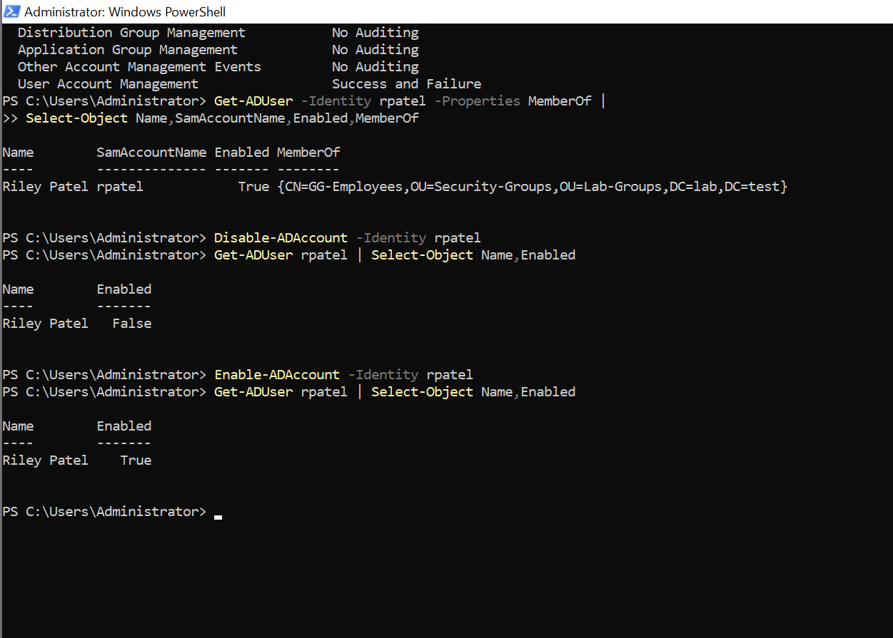
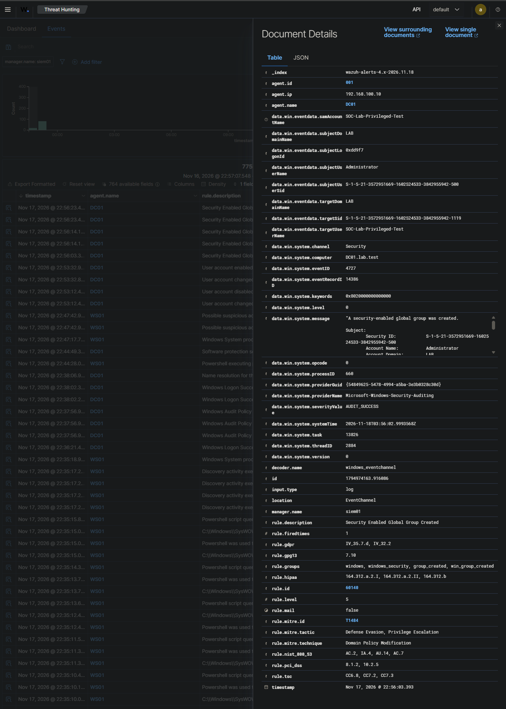
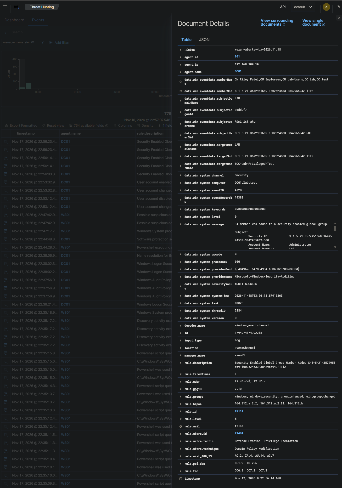
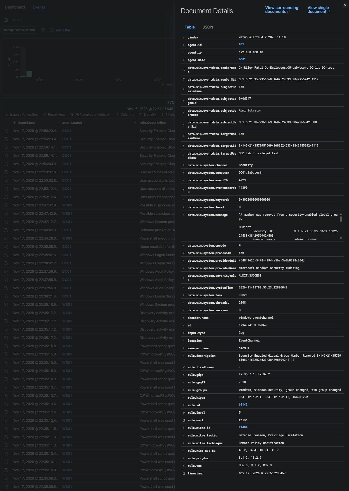
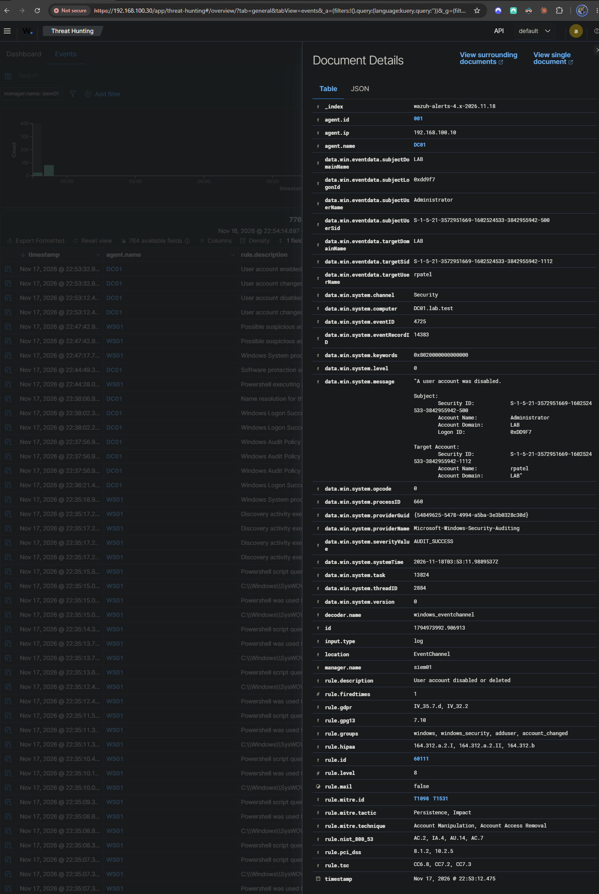
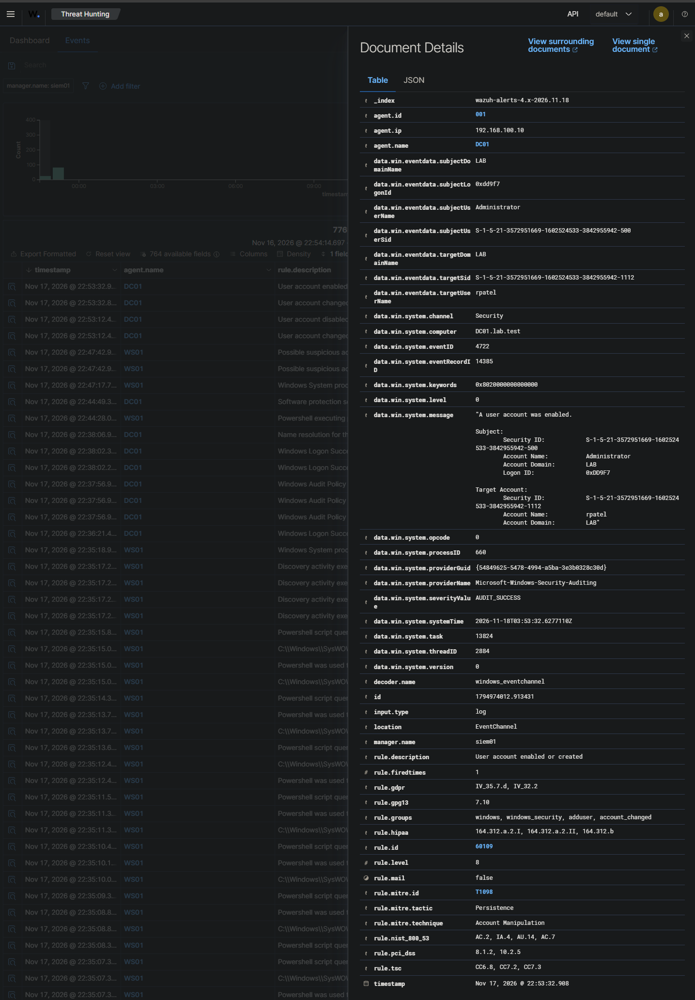

# Investigation 03 — Active Directory Account and Security Group Modification

**Date:** November 17, 2026  
**Environment:** Active Directory Detection Lab  
**SIEM:** Wazuh 4.14.10  
**Domain:** `lab.test`  
**Domain Controller:** DC01 (`192.168.100.10`)  
**Affected Account:** `LAB\rpatel`  
**Administrative Account:** `LAB\Administrator`  
**Test Security Group:** `SOC-Lab-Privileged-Test`  
**MITRE ATT&CK:** T1098 — Account Manipulation; T1484 — Domain or Tenant Policy Modification (Wazuh rule mapping)  
**Final Classification:** Authorized Security Simulation  
**Status:** Closed — Expected Activity

---

## 1. Investigation Summary

A controlled Active Directory account-management simulation was conducted to validate the detection of user account status changes and security group membership modifications.

The investigation focused on two security-relevant scenarios:

1. Disabling and re-enabling an existing Active Directory user account.
2. Creating a security-enabled global group, temporarily adding a user, and removing the user from that group.

The existing domain account `LAB\rpatel` was selected as the test subject.

Windows Advanced Audit Policy had previously been configured through Group Policy to record successful and failed account-management operations.

During the simulation, Windows generated the expected Security Event IDs **4725, 4722, 4727, 4728, and 4729**.

The Wazuh agent installed on DC01 collected the events and forwarded them to the centralized SIEM, where built-in detection rules generated corresponding security alerts.

The investigation demonstrated successful monitoring of Active Directory account modifications, security group changes, and administrative activity.

---

## 2. Lab Environment

| Component | Configuration |
|---|---|
| Active Directory Domain | `lab.test` |
| Domain Controller | DC01 — Windows Server 2022 |
| Domain Controller IP | `192.168.100.10` |
| SIEM Server | SIEM01 — Ubuntu Server / Wazuh 4.14.10 |
| Wazuh Agent | DC01 — Agent ID 001 |
| Audit Source | Windows Security Event Log |
| Administrative Account | `LAB\Administrator` |
| Target Account | `LAB\rpatel` |
| Test Security Group | `SOC-Lab-Privileged-Test` |

### Audit Policy Configuration

The Group Policy Object `SOC-Lab-DC-Security-Auditing` was linked to the Domain Controllers organizational unit.

The following advanced audit policies were configured:

| Audit Subcategory | Configuration |
|---|---|
| Audit User Account Management | Success and Failure |
| Audit Security Group Management | Success and Failure |
| Audit Computer Account Management | Success and Failure |

The settings were applied to DC01 using:

```powershell
gpupdate /force
```

The effective auditing configuration was verified using:

```powershell
auditpol /get /category:"Account Management"
```

The results confirmed that all three required subcategories were configured to audit successful and failed operations.

The Wazuh agent was already configured to collect events from the Windows Security channel.

---

## 3. Investigation Objectives

The primary objective was to determine whether Windows and Wazuh could identify administrative modifications to Active Directory accounts and security groups.

The investigation sought to verify that:

- Disabling an existing user account generates a security event.
- Re-enabling the account generates a separate security event.
- Creating a security-enabled global group is recorded.
- Adding a user to the group generates a membership-change event.
- Removing the user generates a corresponding removal event.
- Wazuh identifies the administrative account responsible for the changes.
- The affected user and security group can be identified from the event details.
- The original account status and group membership can be restored.

---

## 4. Scenario A — Active Directory Account Status Modification

### Initial Account Verification

Before modifying the account, its existing configuration was inspected using:

```powershell
Get-ADUser -Identity rpatel -Properties MemberOf |
Select-Object Name,SamAccountName,Enabled,MemberOf
```

The results confirmed:

| Property | Initial Value |
|---|---|
| Display Name | Riley Patel |
| Username | `rpatel` |
| Account Enabled | `True` |
| Existing Group | `GG-Employees` |

The original account configuration was documented before performing the simulation.

### Step 1 — Disable the Account

The following command was executed on DC01:

```powershell
Disable-ADAccount -Identity rpatel
```

The account status was verified using:

```powershell
Get-ADUser rpatel | Select-Object Name,Enabled
```

The output confirmed:

```text
Name          Enabled
----          -------
Riley Patel   False
```

Windows recorded Event ID **4725 — A user account was disabled**.

Wazuh generated a corresponding Level 8 alert.

### Step 2 — Re-enable the Account

The following command was executed:

```powershell
Enable-ADAccount -Identity rpatel
```

The account status was verified again:

```powershell
Get-ADUser rpatel | Select-Object Name,Enabled
```

The output confirmed:

```text
Name          Enabled
----          -------
Riley Patel   True
```

Windows recorded Event ID **4722 — A user account was enabled**.

Wazuh generated a corresponding Level 8 alert.


### Evidence 1 — Account Disabled and Restored



*Figure 1: PowerShell on DC01 confirms that LAB\rpatel was disabled, verified as Enabled = False, re-enabled, and verified as Enabled = True.*


### Additional Account Modification Event

Windows also recorded Event ID **4738 — A user account was changed**.

This event provided additional evidence of modifications to the target account.

---

## 5. Scenario B — Security Group Membership Modification

A dedicated test security group was created to simulate membership changes without modifying existing administrative groups.

### Step 1 — Create the Test Group

The following command was executed on DC01:

```powershell
New-ADGroup `
  -Name "SOC-Lab-Privileged-Test" `
  -SamAccountName "SOC-Lab-Privileged-Test" `
  -GroupScope Global `
  -GroupCategory Security `
  -Path "OU=Security-Groups,OU=Lab-Groups,DC=lab,DC=test"
```

This created a new security-enabled global group in the lab's Security-Groups organizational unit.

Windows recorded Event ID **4727 — A security-enabled global group was created**.

Wazuh generated a corresponding Level 5 alert.

### Evidence 4 — Security-Enabled Global Group Created



*Figure 4: DC01 Event ID 4727 triggered Wazuh Rule 60140 (Level 5) for creation of SOC-Lab-Privileged-Test. The event identifies LAB\Administrator as the actor.*

**Important:** Despite its name, the test group was not assigned Domain Admin privileges or other administrative permissions. It was created solely to validate security group auditing.

### Step 2 — Add the User to the Group

The following command was executed:

```powershell
Add-ADGroupMember -Identity "SOC-Lab-Privileged-Test" -Members rpatel
```

Windows recorded Event ID **4728 — A member was added to a security-enabled global group**.

Wazuh generated a corresponding Level 5 alert.


### Evidence 5 — Security Group Member Added



*Figure 5: DC01 Event ID 4728 triggered Wazuh Rule 60141 (Level 5). The event identifies LAB\rpatel as the member added to SOC-Lab-Privileged-Test.*

The event identified:

- The administrative account responsible for the change.
- The security group receiving the new member.
- The account added to the group.
- The domain controller that recorded the operation.

### Step 3 — Remove the User from the Group

The user was removed using:

```powershell
Remove-ADGroupMember -Identity "SOC-Lab-Privileged-Test" -Members rpatel -Confirm:$false
```

Windows recorded Event ID **4729 — A member was removed from a security-enabled global group**.

Wazuh generated a corresponding Level 5 alert.

### Evidence 6 — Security Group Member Removed



*Figure 6: DC01 Event ID 4729 triggered Wazuh Rule 60142 (Level 5), documenting removal of LAB\rpatel from the test group.*

### Step 4 — Verify Membership Restoration

The group's membership was checked using:

```powershell
Get-ADGroupMember -Identity "SOC-Lab-Privileged-Test"
```

The command returned no members, confirming that `rpatel` had been successfully removed.

The test group remained available for future controlled simulations.

---

## 6. Relevant Security Events and Wazuh Rules

All five primary security events were observed in Wazuh.

| Windows Event ID | Activity | Wazuh Rule | Alert Level |
|---|---|---|---|
| 4725 | User account disabled | 60111 | 8 |
| 4722 | User account enabled | 60109 | 8 |
| 4727 | Security-enabled global group created | 60140 | 5 |
| 4728 | Member added to security-enabled global group | 60141 | 5 |
| 4729 | Member removed from security-enabled global group | 60142 | 5 |

An additional account modification event was observed:

| Windows Event ID | Activity | Wazuh Rule | Alert Level |
|---|---|---|---|
| 4738 | User account changed | 60110 | 8 |

### Detection Sources

All events originated from the Windows Security Event Log on DC01.

The Wazuh agent forwarded the relevant events to SIEM01, where built-in rules identified the account and group modifications.

No custom Wazuh detection rules were required for these scenarios.

---

## 7. Alert Analysis

### Account Disable Detection

**Windows Event ID:** 4725  
**Wazuh Rule:** 60111  
**Severity:** Level 8

The alert identified:

- **Subject Account:** `LAB\Administrator`
- **Target Account:** `LAB\rpatel`
- **Domain Controller:** DC01
- **Action:** User account disabled

The detection confirmed that Windows auditing could identify the administrative account responsible for disabling a domain user.

### Evidence 2 — Account Disabled — Event ID 4725



*Figure 2: Wazuh Rule 60111 (Level 8) records the disabling of LAB\rpatel by LAB\Administrator on DC01.*


### Account Enable Detection

**Windows Event ID:** 4722  
**Wazuh Rule:** 60109  
**Severity:** Level 8

The alert identified:

- **Subject Account:** `LAB\Administrator`
- **Target Account:** `LAB\rpatel`
- **Domain Controller:** DC01
- **Action:** User account enabled

The detection confirmed that account reactivation was recorded separately from account disabling.

### Evidence 3 — Account Enabled — Event ID 4722



*Figure 3: Wazuh Rule 60109 (Level 8) records the re-enabling of LAB\rpatel by LAB\Administrator on DC01.*


### Security Group Creation Detection

**Windows Event ID:** 4727  
**Wazuh Rule:** 60140  
**Severity:** Level 5

The alert confirmed the creation of:

`SOC-Lab-Privileged-Test`

The event identified `LAB\Administrator` as the account responsible for creating the group.

### Group Membership Addition Detection

**Windows Event ID:** 4728  
**Wazuh Rule:** 60141  
**Severity:** Level 5

The alert confirmed that `rpatel` was added to the security-enabled global group `SOC-Lab-Privileged-Test`.

Relevant event fields included:

- `memberName`
- `memberSid`
- `targetUserName`
- `subjectUserName`
- `targetDomainName`

These fields provided the information necessary to identify the affected group, modified membership, and responsible administrator.

### Group Membership Removal Detection

**Windows Event ID:** 4729  
**Wazuh Rule:** 60142  
**Severity:** Level 5

The alert confirmed that `rpatel` was removed from `SOC-Lab-Privileged-Test`.

The event identified the same administrative account and target group.

This demonstrated that Wazuh could distinguish membership additions from membership removals.

---

## 8. MITRE ATT&CK Mapping

The observed activity is relevant to Active Directory account manipulation and security group monitoring.

| Technique | Description | Relevance |
|---|---|---|
| T1098 — Account Manipulation | Modification of user accounts or group memberships | Applicable to the account and group changes investigated |
| T1484 — Domain or Tenant Policy Modification | Changes to domain policy or related configurations | Mapping associated with the built-in Wazuh group-change rules |

The account-modification alerts were associated with **T1098 — Account Manipulation**.

The group-management alerts were mapped by Wazuh to **T1484 — Domain or Tenant Policy Modification**.

These mappings describe potentially relevant attacker techniques. They do not establish that the authorized test actions were malicious.

In particular, membership changes to the unprivileged test group did not grant administrative access or demonstrate privilege escalation.

---

## 9. Investigation Findings

The investigation established that:

- DC01 successfully applied the configured Account Management auditing policies.
- Windows generated the expected events for user account disabling and enabling.
- Windows recorded the creation of a security-enabled global group.
- Group membership additions and removals generated separate security events.
- The DC01 Wazuh agent successfully forwarded all five primary event types.
- Wazuh generated corresponding alerts using its built-in detection rules.
- The alerts identified the administrative account responsible for each operation.
- The affected account and security group were identifiable from event details.
- The test user's original enabled state was restored.
- The test user was removed from the temporary security group.

### Detection Validation

The investigation validated the following pipeline:

1. An administrative operation was executed on DC01.
2. Active Directory processed the account or group modification.
3. Windows Security auditing recorded the corresponding event.
4. The Wazuh agent collected the security event.
5. SIEM01 received and analyzed the event.
6. A built-in Wazuh rule generated a security alert.
7. The analyst verified the affected account, administrative identity, and modification details.

The test demonstrated successful centralized monitoring of security-relevant Active Directory administrative operations.

---

## 10. Analyst Assessment

**Classification:** Authorized Security Simulation — True Positive Detections

The generated alerts accurately reflected the account and security group modifications performed during the investigation.

The detections were considered true positives because the observed operations matched their intended detection categories.

However, all changes were authorized and deliberately executed within the isolated lab environment.

No unauthorized administrator activity, account compromise, or privilege escalation was demonstrated.

### Production SOC Considerations

In an enterprise environment, similar alerts would warrant investigation into:

- Whether the administrator was authorized to perform the modification.
- Whether the change was associated with an approved ticket or maintenance activity.
- Whether the affected account belonged to a privileged or sensitive user.
- Whether the modified group provided access to sensitive resources.
- Whether membership changes occurred outside normal business hours.
- Whether the modification originated from an unusual administrative account or workstation.
- Whether the account exhibited suspicious authentication or endpoint activity afterward.
- Whether unexpected access or persistence mechanisms were established.

Unexpected modifications to privileged groups such as Domain Admins would generally require greater scrutiny than changes to an ordinary security group.

The security impact of a group membership change depends on the permissions assigned to that group.

---

## 11. Conclusion

The Active Directory account and security group modification investigation was successful.

Windows Advanced Audit Policy recorded account status changes and security-enabled global group modifications.

The DC01 Wazuh agent forwarded the resulting events to the centralized SIEM, where built-in detection rules generated corresponding alerts.

All five primary security events were detected:

- 4725 — Account disabled
- 4722 — Account enabled
- 4727 — Security group created
- 4728 — Group member added
- 4729 — Group member removed

The investigation demonstrated the ability to monitor administrative changes, identify responsible accounts, determine affected objects, and validate security detections against known test activity.

The test account was restored to its original enabled state, and the temporary security group was left without members.

**Final Disposition:** Closed — Authorized simulation; no malicious incident confirmed.

---

## 12. Skills Demonstrated

- Active Directory administration
- Advanced Audit Policy configuration
- Group Policy management
- Windows Security Event Log analysis
- User account lifecycle monitoring
- Security group membership monitoring
- PowerShell Active Directory administration
- Wazuh SIEM event collection
- Detection rule validation
- Security alert investigation
- MITRE ATT&CK mapping
- Security investigation documentation

---

**Project:** [Active Directory Detection Lab](../README.md)

**Investigation Status:** Completed  
**Detection Result:** Successful — Five primary security events detected  
**Final Classification:** Authorized Security Simulation
